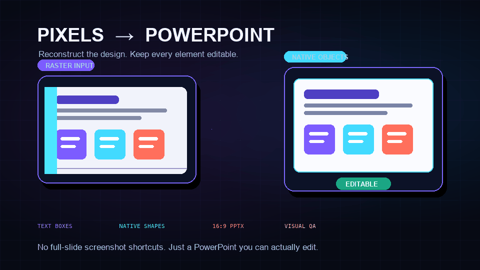
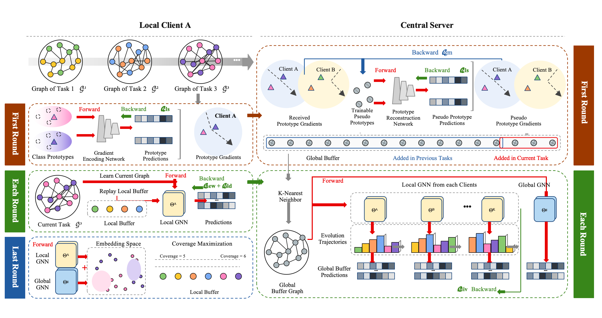
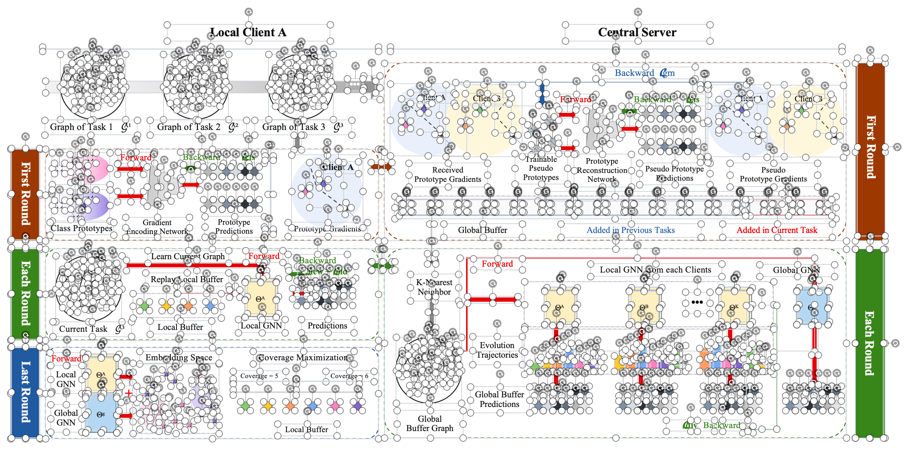

<p align="center">
  
</p>

<h1 align="center">Image2PPT Skill</h1>

<p align="center">
  <strong>Pixels in. Editable PowerPoint out.</strong>
  <br />
  Reconstruct screenshots and reference images as high-fidelity, fully editable 16:9 presentations.
</p>

<p align="center">
  <a href="https://github.com/koen666/Image2PPT-Skill/stargazers"></a>
  
  
  
</p>

<p align="center">
  <a href="#quick-start">English</a> · <a href="#中文说明">简体中文</a> · <a href="#quality-gates">Quality gates</a>
</p>

<p align="center">
  <picture>
    <source media="(prefers-reduced-motion: reduce)" srcset="assets/hero-poster.png" />
    
  </picture>
</p>

---

Image2PPT is a Codex Skill for the annoying kind of conversion that ordinary image-to-PPT tools avoid: **rebuilding the slide itself**.

It reads the reference as a visual contract, recovers the visible text, measures the composition, rebuilds simple visuals with native PowerPoint objects, and verifies the rendered result. The source screenshot is never used as a full-slide shortcut.

## Why Image2PPT?

<table>
  <tr>
    <td width="50%">
      <h3>✦ High-fidelity reconstruction</h3>
      Reproduce layout, hierarchy, colors, typography, spacing, borders, shadows, crops, and visual rhythm from the source.
    </td>
    <td width="50%">
      <h3>⌘ Actually editable</h3>
      Turn visible copy into text boxes and rebuild cards, arrows, charts, tables, badges, dividers, and color blocks as native objects.
    </td>
  </tr>
  <tr>
    <td width="50%">
      <h3>◫ Honest raster handling</h3>
      Keep only photographs and genuinely complex artwork as tightly cropped images. External labels and annotations stay editable.
    </td>
    <td width="50%">
      <h3>✓ Built-in quality gates</h3>
      Render every slide, compare it with the reference, detect overflow, and flag suspicious full-slide images before delivery.
    </td>
  </tr>
</table>

## The reconstruction contract

```text
Reference image
      │
      ▼
OCR + geometry + visual inventory
      │
      ▼
Native PowerPoint reconstruction
      │
      ▼
Render → compare → inspect → refine
      │
      ▼
16:9 .pptx with independently editable elements
```

| Requirement | Image2PPT behavior |
| --- | --- |
| Text | Recreated as editable text boxes, with copy and line breaks verified against the source |
| Layout | Measured in normalized coordinates and mapped to a 16:9 canvas |
| Charts and diagrams | Rebuilt with native charts or editable PowerPoint shapes when the data is recoverable |
| Cards, arrows and color blocks | Recreated as native shapes and connectors |
| Photos and complex artwork | Preserved as tightly cropped raster regions without adjacent labels |
| Full-slide screenshot | Explicitly forbidden and checked during QA |

## Real-world example / 真实案例

<p align="center">
  <strong>A dense graph-learning architecture figure, reconstructed as independently editable PowerPoint elements.</strong>
  <br />
  复杂图学习架构图：从参考图片重建为可单独选择和修改的 PowerPoint 元素。
</p>

<table>
  <tr>
    <th width="50%">Reference image · 原始参考图</th>
    <th width="50%">Editable result · 可编辑重建结果</th>
  </tr>
  <tr>
    <td align="center">
      <a href="assets/showcase/graph-learning-reference.png">
        
      </a>
    </td>
    <td align="center">
      <a href="assets/showcase/graph-learning-editable-selected.png">
        
      </a>
    </td>
  </tr>
  <tr>
    <td>Dense raster reference with graphs, arrows, labels, cards, and repeated visual structures.</td>
    <td>The selection handles are intentionally visible: text boxes, lines, nodes, panels, and labels remain separate PowerPoint objects.</td>
  </tr>
</table>

<p align="center">
  <sub>Click either image to inspect it at full resolution. The right-hand screenshot shows editability—not a flattened background image.</sub>
</p>

## Quick start

### 1. Install the Skill

Clone the repository into your Codex skills directory:

```bash
git clone https://github.com/koen666/Image2PPT-Skill.git \
  ~/.codex/skills/image-to-editable-pptx
```

Restart Codex after installation. This Skill is designed to work alongside the bundled `Presentations` Skill and its current PowerPoint rendering workflow.

### 2. Invoke it

Attach one or more reference images, then use a prompt like:

```text
Use $image-to-editable-pptx to reconstruct the attached image as a 16:9 PPTX.
Match the source as closely as possible. Keep all text editable, rebuild simple
visuals with native PowerPoint objects, and do not use the image as a full-slide background.
```

One reference image maps to one slide by default.

## What it handles

- Slide screenshots and slide-preview images
- Posters, infographics, process diagrams, and architecture diagrams
- Dashboards, scorecards, charts, tables, cards, and metric layouts
- Chinese, English, and mixed-language text
- Multiple reference images in a single deck
- Non-16:9 references that must be adapted without stretching or silently cropping content

## Quality gates

The Skill includes two lightweight QA utilities.

### Detect screenshot-only slides

```bash
python scripts/verify_editability.py output.pptx --strict
```

This inspects the PowerPoint package for editable text and native objects, confirms the 16:9 aspect ratio, and warns about near-full-slide pictures or raster-only slides.

### Compare the render with the reference

```bash
python scripts/compare_reference.py \
  reference.png rendered-slide.png --diff visual-diff.png
```

This reports pixel and edge similarity and can create an emphasized difference image. It requires [Pillow](https://pillow.readthedocs.io/). Similarity scores are diagnostic; full-size visual inspection remains mandatory.

## Inside the Skill

| Path | Purpose |
| --- | --- |
| [`SKILL.md`](SKILL.md) | Core execution contract and reconstruction workflow |
| [`references/reconstruction-playbook.md`](references/reconstruction-playbook.md) | Geometry, typography, native-object, raster, and layering guidance |
| [`references/qa-checklist.md`](references/qa-checklist.md) | Fidelity and editability delivery gate |
| [`scripts/verify_editability.py`](scripts/verify_editability.py) | Structural inspection for editable objects and suspicious images |
| [`scripts/compare_reference.py`](scripts/compare_reference.py) | Reference-versus-render visual comparison |

## 中文说明

Image2PPT 是一个面向 Codex 的“图片转可编辑 PowerPoint”Skill。它不是把原图贴到幻灯片上，而是按照参考图重新测量和搭建页面：

- 图片中的文字识别后转换为可编辑文本框；
- 图表、箭头、色块、卡片和表格尽量使用 PPT 原生元素重建；
- 照片和复杂插画可以保留为紧密裁切的图片，但外部标注必须可编辑；
- 默认输出 16:9 `.pptx`，所有元素可单独选中、移动和修改；
- 输出前会逐页渲染、检查溢出，并识别“整页截图伪装成 PPT”的情况。

安装：

```bash
git clone https://github.com/koen666/Image2PPT-Skill.git \
  ~/.codex/skills/image-to-editable-pptx
```

调用示例：

```text
使用 $image-to-editable-pptx 将附件图片严格复刻为 16:9 PowerPoint。
所有文字必须可编辑；简单图表和图形使用 PPT 原生元素重建；
不要把原图直接作为整页背景。
```

## Contributing

Fidelity problems, new reconstruction patterns, and QA improvements are welcome. Open an issue with the reference image, the rendered slide, and a short description of the mismatch—or send a focused pull request.

<p align="center">
  <strong>If Image2PPT saves you from rebuilding a slide by hand, consider giving it a ⭐.</strong>
</p>
